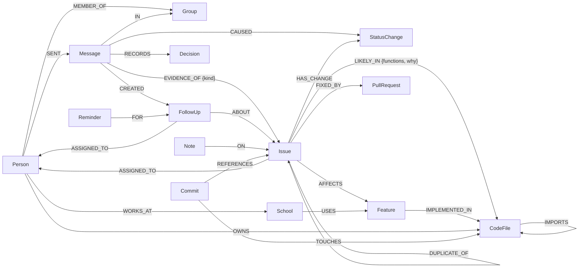
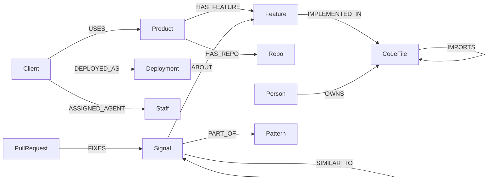

# Loopkeeper: Ednovax Support Desk

**A support desk for software teams whose customers live on WhatsApp, not in a ticketing tool. Built on FalkorDB.**

Ednovax builds school management software for schools in Nigeria. All of its support happens in WhatsApp groups: teachers report bugs, ask questions and chase updates between greetings, prayers and birthday wishes. Nothing is tracked, promises are forgotten, and developers never see what the teachers actually said.

Loopkeeper reads those groups and runs the support desk from them. It drops the small talk and turns the rest into tickets, promises and decisions in a FalkorDB graph. Each ticket is linked to the school, the people involved, the product feature, the code most likely at fault (found by reading the repository) and the developer who owns it. It tracks response times against each school's plan, notices when several schools hit the same bug without showing one school's data to another, sends tickets to GitHub with full context, and follows the fix back to the school when the pull request merges. Anyone on the team can ask it questions in plain English and get answers with sources.

- **Live:** https://support.ednovax.com
- **Demo video:** _link to be added_
- **Hackathon:** Graph Hacks: Context for AI Agents (WeMakeDevs × FalkorDB)
- **Tracks:** 03 Company Brain, 01 Agents That Act on Connected Data

## What you can do in the demo

The live desk runs one real Ednovax school, **Henson** (Benin City), connected to its real GitHub repositories. Its four teachers are **played by AI**; everyone at Ednovax is a real person on the desk.

1. Press **Go live**. A teacher reports a problem in the school's WhatsApp group. The desk opens a ticket, links it to the feature, reads the code and names the files and functions most likely involved.
2. Reply in the group (Conversations, or the client page). Ask for details and the teacher answers; ignore them and they chase you, and the principal steps in.
3. Open the ticket and **Send to GitHub**: the issue is written from the graph (what the school said, where it lives in the code, who owns it).
4. Close the ticket, or merge the fix. The teacher tries it and tells you whether it works. One problem fails its first fix on purpose.
5. Try **Ask** ("what is Henson waiting on?", "where in the code is the scores bug?"), **Patterns**, **Analytics**, **Network** (explore the graph like FalkorDB Browser: run read-only Cypher, click any node for its properties) and **Database** (FalkorDB at work: every graph, its indexes and each query as it runs).

**To try the live desk, sign in as the demo visitor** (`demo@ednovax.com`, listed on the login page with its password). It sees only the demo school and can do everything above except send to GitHub and change settings. The staff accounts (Ednovax Support, Blessed Oigbochie, tech lead, Maro Orode, CTO) are for the Ednovax team; the live desk also serves real schools, which the demo account never sees.

## Run it locally

Requirements: **Node 20.19 or newer**, **Docker**, and an **Anthropic API key** (to read the chats). A GitHub token is optional (to read repositories and open issues). Keys are added in the app, not in files.

```bash
git clone https://github.com/ImStillBlessed/loopkeeper.git
cd loopkeeper
npm install
cp .env.example .env     # infrastructure only: FalkorDB address, APP_SECRET, ID_HASH_SALT
npm run db:up            # FalkorDB on 127.0.0.1:6379 (FalkorDB Browser on http://localhost:3000)
npm run dev              # API on :8787, dashboard on http://localhost:5173
```

1. Open http://localhost:5173 and sign in with one of the accounts listed on the login page (password `ednovax-demo`).
2. **Settings → Connections:** paste your Anthropic key (and a GitHub token if you have one).
3. Press **Go live**.

On first start the app creates every graph it needs and seeds HQ, the staff and the Henson school. The local embedding model (all-MiniLM-L6-v2, about 23 MB) downloads once on first use; `npm run model:fetch` downloads it ahead of time.

> On Windows use `FALKORDB_HOST=127.0.0.1`, not `localhost`, which can resolve to another Redis (e.g. inside WSL).

Other commands:

```bash
npm test                 # all tests, against a real FalkorDB (a scripted model, no API key needed)
npm run typecheck        # server and dashboard
npm run db:check         # FalkorDB smoke test: indexes, vector search, WCC, PageRank, shortest path
npm run chat             # the desk from the terminal: reply, go live, raise a problem, ask
npm run build && npm start   # production: one process serves the API and the built dashboard
```

## How it works

```text
WhatsApp group ─▶ inbox (batches messages that arrive together)
                ─▶ triage (fast model): small talk is counted, never stored
                ─▶ work: store the Message with its embedding
                ─▶ pull candidate tickets FROM THE GRAPH (same school, closest in meaning, recent, just resolved)
                ─▶ extract (model): new tickets / updates / promises / decisions, each linked to its message
                ─▶ new ticket: vector search over the code ─▶ the model reads the closest files ─▶ LIKELY_IN
                                vector index ─▶ SIMILAR_TO ─▶ WCC ─▶ judge ─▶ DUPLICATE_OF
                                an abstract Signal in HQ ─▶ pattern across clients (counts only)
                ─▶ reminders for promises that fall due

GitHub ─▶ repo index: files, imports, CODEOWNERS, features, and each file's functions + embedding
       ─▶ pull requests, pushes, closed issues ─▶ FIXED_BY / REFERENCES / TOUCHES ─▶ status changes, back to the school

Central support hub ─▶ each forwarded message is routed to its client (named, known contact, same thread, or the model)
```

- **The graph steers the model.** Before reading a message, FalkorDB hands the model the tickets it might be about, so it says "this is ticket X again" instead of opening a duplicate.
- **Code is read, not guessed.** Connecting a repository reads every source file: what it defines (functions, classes, routes) is embedded into a vector index. A new ticket searches it, and the model reads the source of the closest files before naming the likely files and functions.
- **Ask** only answers through tools, and every tool is a named Cypher query. Answers cite their messages, list the queries they ran, and highlight the nodes they touched. It can also search and read the code, open a GitHub issue, and store what it's told.
- **Models:** Anthropic Claude (Haiku by default) for triage, extraction and Ask; embeddings run locally (384 dimensions). Changeable in Settings.

## Graph data model

FalkorDB is the only database. The app keeps several graphs:

| Graph | Holds |
|---|---|
| `lk_hq` | Ednovax itself: products, features, code, staff, SLA policies, the client registry and deployments, and abstract signals and patterns across clients. **Never message text or contact names** (a test checks this). |
| `lk_client_<id>` | One per client: its WhatsApp groups, people, messages, tickets, promises, decisions, Ask conversations, and its copy of the product's code reference. A query on one client's graph can't reach another's. |
| `lk_hub` | The central support hub: messages staff forward from many schools, and where each one was routed. |
| `lk_desk` | Ask conversations across clients. |
| `loopkeeper` | App settings (keys encrypted with `APP_SECRET`). |

### A client's graph



Also in a client's graph: `Client`, `Repo`, `Conversation` (Ask, with `USED` links to the nodes an answer drew on) and `Simulation` (the demo school's state).

### HQ



A `Signal` is the abstract trace a client's ticket leaves in HQ: feature, severity, status and an embedding, with any client or contact name removed. Patterns across clients form from signals alone.

### Indexes

- **Vector (384 dimensions, cosine):** `Message.embedding`, `Issue.embedding`, `Signal.embedding`, `CodeFile.embedding`.
- **Range:** ids and lookup keys on every label (`Issue.status`, `Feature.key`, `Staff.email`, `Signal.clientId`, …). See [`src/graph/schema.ts`](src/graph/schema.ts).

## Cypher queries and graph algorithms

Every query the product runs is a **named Cypher query** with a stable id (182 in all), in three files:

- [`src/graph/queries.ts`](src/graph/queries.ts): a client's graph. `W` writes from the pipeline, `C` context handed to the model, `Q` reads for the dashboard and the agent's tools, `IX` repository indexing, `GH` GitHub, `RP` copying the product reference, `SIM` the demo school, `DB` the Database page.
- [`src/graph/hq-queries.ts`](src/graph/hq-queries.ts): HQ. `H` products, staff and the registry, `HD` deployments, `HG` repositories and webhooks, `X` signals and patterns across clients, `I` health and SLA.
- [`src/graph/hub-queries.ts`](src/graph/hub-queries.ts): the central support hub (`HB`).

The ones the product depends on most:

| Id | What it does | FalkorDB feature |
|---|---|---|
| `C3`, `C9`, `Q10` | Tickets closest in meaning to a message, a ticket, or a question | vector index |
| `C14` | Code files closest in meaning to a problem | vector index |
| `Q20` | Semantic search over messages and team notes | vector index |
| `X3` | Signals from other clients on the same feature that read alike | vector index |
| `C10`, `Q6`, `X5` | Duplicate tickets and cross-client patterns as clusters | `algo.WCC` |
| `Q7` | Open tickets ranked by how much evidence and how many links they have | `algo.pageRank` |
| `Q9` | How two things are connected (e.g. a teacher and a developer) | `shortestPath` |
| `Q2` | Ticket → feature → code files → owners | multi-hop traversal |
| `Q3b` | Code that imports the affected files, up to three hops (what else could break) | variable-length path |
| `W4` | Assign a new ticket to whoever owns most of its feature's code | traversal + aggregation |
| `W3`, `W6`, `W20` | Open a ticket, change its status, link it to the code, each traced to its source | writes |

The **Database** page shows these running live, with FalkorDB's own execution time, what each one wrote, and whether it used a vector index.

## Deployment

The live desk runs on a VPS behind Caddy and nginx, with its own FalkorDB in Docker on `127.0.0.1`. Everything is in [`deploy/`](deploy/):

- [`.github/workflows/deploy.yml`](.github/workflows/deploy.yml): every push and pull request runs the typecheck, the tests (against a FalkorDB service container) and the build. A push to `main` copies the code and the built dashboard to the server, downloads the embedding model and restarts the desk.
- [`deploy/setup-server.sh`](deploy/setup-server.sh): one-time server setup (`.env` with generated secrets, FalkorDB, the systemd service, the nginx site).
- [`deploy/nginx-support.ednovax.com.conf`](deploy/nginx-support.ednovax.com.conf), [`deploy/docker-compose.yml`](deploy/docker-compose.yml), [`deploy/support-desk.service`](deploy/support-desk.service).

On a public server set `DEMO_PASSWORD` and `SHOW_DEMO_ACCOUNTS=false` in `.env` (the staff accounts), keep `SHOW_DEMO_VISITOR=true` (the demo account, which only sees the demo school; `DEMO_VISITOR_PASSWORD` sets its password), and set `PUBLIC_URL` so the GitHub and WhatsApp webhook URLs shown in Settings are right.

## Project layout

```text
src/
  graph/      FalkorDB client, schema (indexes), all named Cypher queries, the query log
  ingest/     WhatsApp export parser, live messages, id hashing (phone numbers are never stored)
  pipeline/   triage → extract → apply (tickets, duplicates, status, promises, decisions, likely code) → reminders
  agent/      Ask: tools (each one a Cypher query) and the tool-calling loop, shared conversations
  hq/         HQ seed, cross-client signals and patterns, SLA and health, suggested replies
  hub/        the central support hub: routing and importing exported chats
  github/     repository indexer and code reading, issues, pull request / push activity, connection health
  whatsapp/   WhatsApp Cloud API (groups, webhook)
  runtime/    the running app: clients, inbox, chat clock, event stream, the demo school's teachers
  server/     Hono API, live event streams, GitHub and WhatsApp webhooks
  llm/        Anthropic client, local embeddings, reply cache, prompt loader
web/          Vite + React dashboard (Tailwind, shadcn components)
cli/          npm run chat
prompts/      every prompt, as Markdown
data/demo/    the live demo: staff, the Henson school, its teachers and their problems
data/synthetic/  fictional clients and chats used by the tests, and the demo product reference
deploy/       server setup, nginx, systemd, FalkorDB for production
tests/        parser, routing, insights, the teachers, code reading, and the full pipeline against FalkorDB
```

## Data

The teachers, their problems and all synthetic chats are fictional. No real student data is used. See [data/README.md](data/README.md).
